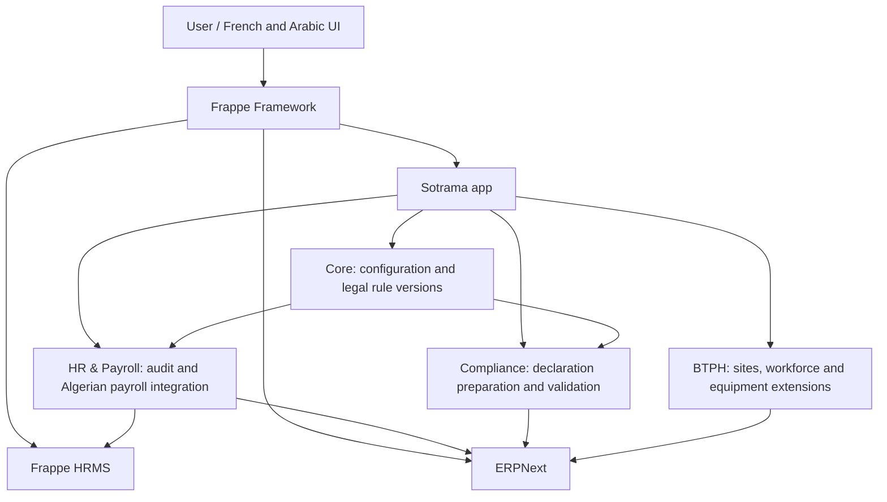

# Architecture

## Application boundary

Sotrama is a Frappe app package (`sotrama`) installed into a Bench. ERPNext and HRMS remain separate installed apps. Sotrama owns its DocTypes, Python controllers, reports, pages, fixtures, patches, print templates and test code; it references standard ERPNext/HRMS documents through links and their documented APIs.

## Modules

- **Sotrama Core:** application settings, Algeria/company settings, reference data, legal sources and effective-dated rule versions, validation utilities and audit records.
- **Sotrama HR Payroll:** classification of salary components, payroll period review, calculation audit and declaration inputs. HRMS remains the payroll engine; Sotrama must not replace Salary Slip or its calculation lifecycle.
- **Sotrama Compliance:** obligation calendar, validation, declaration preparation and exports (G50, G29, DAS, DAC only after requirements and official formats are confirmed).
- **Sotrama BTPH:** chantier/site links, worker assignment, equipment and activity reporting; ERPNext projects/assets and HRMS employees remain authoritative where applicable.

## Payroll integration principles

1. Inspect exact installed Frappe/ERPNext/HRMS source versions and extension points before implementing hooks.
2. HRMS 16.53.1 exposes `SalarySlip.apply_regional_deductions()` and `SalarySlip.apply_regional_employer_contributions()`, both decorated with `@hrms.allow_regional`. `calculate_net_pay()` calls the employee hook after structure deductions and before final deduction/net totals, and the employer hook after structure employer contributions. Register regional overrides through the supported `regional_overrides` mapping; integration tests must verify company-country dispatch and saved-slip/preview behavior.
3. Do not monkey-patch or override the complete Salary Slip/Payroll Engine. Keep legal calculations in isolated, pure Python functions and integrate through supported lifecycle hooks.
4. Each salary component needs explicit tax/social treatment metadata. Component abbreviations alone must not decide a legal base.
5. Keep separate CNAS, CACOBATPH and IRG bases. A contribution base cannot silently be reused for another levy.
6. Every rule has source, version, effective dates, parameters and review status. Payroll audit records retain the exact rule version and input snapshot used; later rules must not rewrite history.
7. No default legal rate or exemption is production-active without source verification and reviewed test cases.

## Packaging and upgrade model

The app is packaged as a Python module with Frappe's conventional `hooks.py`, `modules.txt`, `patches.txt`, `config`, `fixtures`, `public`, `templates`, `www` and module directories. Schema changes use additive DocType changes and forward patches. Patches must be idempotent, preserve existing records, and never delete/overwrite payroll records. Fixtures are limited to safe reference data and reviewed configuration.

## Permissions

Use dedicated roles for Sotrama configuration, payroll review and compliance. Enforce permissions server-side on DocTypes, reports, exports and whitelisted methods. Payroll and personal data access must be restricted to authorized HR/payroll roles. Hiding UI actions is not authorization.

## Compatibility (not yet certified)

| Component | Observed/reported version | Status |
|---|---:|---|
| Frappe | 16.55.2 (WSL report, 9 Nov 2026) | Not tested from this repo |
| ERPNext | 16.54.0 (WSL report) | Not tested from this repo |
| HRMS | 16.53.1 (WSL report) | Not tested from this repo |
| Python | 3.14.0 (Bench venv); 3.12.3 (WSL system); 3.15.0 (Windows) | App metadata and CI target 3.14 |
| Bench | 5.31.1 (WSL) | Located at `/home/frappeuser/frappe-bench`; old site left read-only |

No compatibility claim should be made until clean-site install, migrate, unit tests and integration tests pass against a documented matrix.

## HRMS regional payroll extension points

The installed HRMS 16.53.1 source was inspected at `hrms/payroll/doctype/salary_slip/salary_slip.py`: both methods exist on `SalarySlip` and are decorated with `@hrms.allow_regional`. `calculate_net_pay()` invokes the employee hook after structure deductions and invokes employer contributions after structure employer-contribution rows. The app has not registered an override; implementation still requires exact dispatch verification and tests against the company's country.
